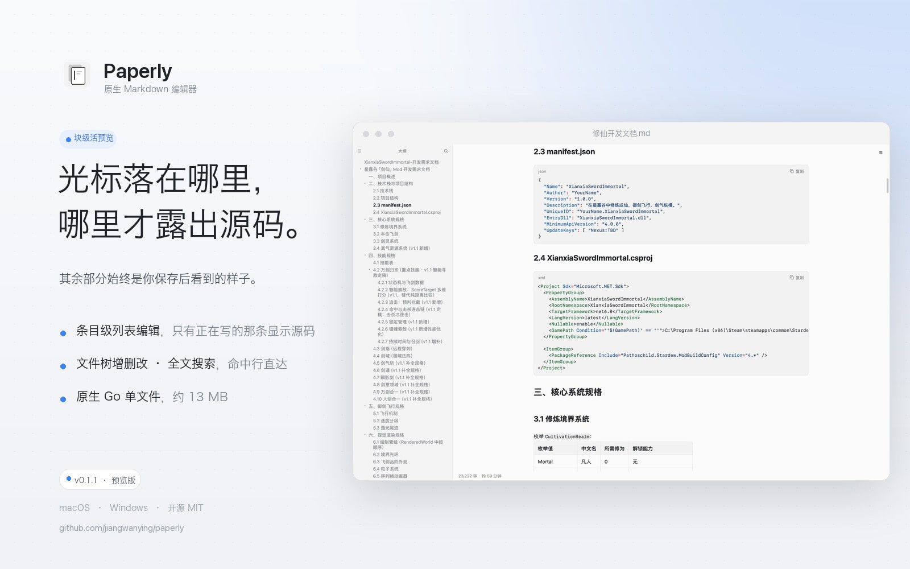
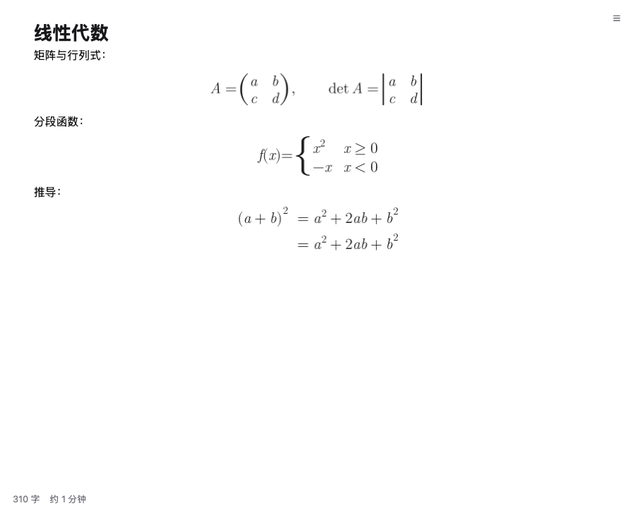

<div align="center">

#  Paperly

**An open-source, native, single-binary Markdown editor — built with Go + MyGo's native UI**

The block under the caret shows its source; everything else always looks the way it will when you save.

[](#) [](https://mygo.run) [](#) [](#) [](#build-from-source)



<sub>English · [简体中文](README.md)</sub>

</div>

> [!IMPORTANT]
> **Early preview (v0.1.3)** — the core writing experience is complete: live preview, item-level list editing, table editing, maths, cross-block selections, PDF export, file management, full-text search, and `.md` associations on both platforms. The details are still being polished, and the features on the roadmap (drag-and-drop images) are not here yet.
>
> Found a bug, something that feels off, or a feature you want? [Open an issue](https://github.com/jiangwanying/paperly/issues); a [pull request](https://github.com/jiangwanying/paperly/pulls) is even more welcome.

---

## Contents

- [Why Paperly](#why-paperly)
- [Features](#features)
- [Quick start](#quick-start)
- [Keyboard shortcuts](#keyboard-shortcuts)
- [How it compares](#how-it-compares)
- [Install](#install)
- [Build from source](#build-from-source)
- [Architecture](#architecture)
- [Roadmap](#roadmap)
- [FAQ](#faq)
- [Feedback and contributions](#feedback-and-contributions)
- [License](#license)

---

## Why Paperly

Markdown editors come in two camps:

- **The Typora camp** (WYSIWYG): a lovely feel, but the editor is a Chromium shell underneath, closed source and paid;
- **The Obsidian / VS Code camp** (source plus preview): powerful and extensible, but Electron costs a few hundred megabytes of memory, or you edit in one pane and read in another.

Paperly takes a third path: **a native app written in Go with [MyGo](https://mygo.run)** — the interface is drawn with native controls, with no Chromium and no WebView — a few megabytes on disk and light on memory, bringing Typora's block editing together with Obsidian's live preview. The whole design follows one rule:

> **The truth is always plain Markdown.** A file is an ordinary `.md`; there is no private format and no database lock-in, and you can move to any other editor whenever you like. Rendering is only a display state: the caret enters a block and that block turns back into source for you to edit; the caret leaves and it returns at once to how it will look.

## Features

### 1. Live preview

- The line with the caret shows its source: `#`, `**`, `` ` `` and friends go faint, so reading is not interrupted
- Every other block stays truly rendered: heading sizes, bold, code chips, tables, task checkboxes
- **Type and it transforms**: `# ` becomes a heading, `- ` a list, `> ` a quote
- Line markers (`- `, `> `, `1. `) stay faintly visible — lists keep their bullets, quotes keep their bar
- Esc commits the current block, which is parsed and rendered again whole

### 2. Item-level list editing

Lists are what you write most, so Paperly takes Typora's block in-and-out down to **each list item**:

<p align="center">
  
</p>

- The item being edited is a source input; the other items in the same list are **truly rendered** — code chips, bold, numbering and hanging indent match the reading view pixel for pixel
- Click any rendered item and the caret lands in that item
- `↑` at the start of an item goes to the end of the one above; `↓` at the end goes to the start of the one below
- Return at the end of an item continues the list (`1.` counts on to `2.`); Return in the middle splits the item in two
- Backspace at the start joins it to the item above, marker and all; Backspace in an emptied item leaves the list and opens a paragraph

### 3. File management

- **Document tree**: browse folders, create files and folders with inline naming (`.md` is appended for you)
- **Rename**: rename inline from the context menu; a file that is open follows to its new path with unsaved text intact, and renaming a folder brings every open document inside it along
- **Delete**: moves the file to the system trash, so it can be brought back; a file with unsaved changes refuses to go and asks you to save first
- Right-click any block, images included: **Delete Block** sits at the top level of the menu

### 4. Full-text search

The search field in the sidebar goes past file names:

- Every matching file is listed with its matching lines (line number, and the keyword in bold)
- Click a matching line to open the file and scroll to it
- Binary and very large files are skipped, and results are cached so typing stays smooth

<p align="center">
  
</p>

### 5. Links and images

- **Links are clickable** — a click in the reading view no longer drops you into editing:
  - `https://…` and `mailto:` → the default browser
  - `#heading` → scrolls to that heading in this document
  - a relative path to another `.md` in the folder → opens that document in Paperly (wiki-style links)
  - any other existing file → the default app for it
- **Images**: pasted or inserted images land in an `assets/` folder beside the document (spaces in file names are escaped); an image alone in its own block opens large on click — a dark lightbox, closed by a click anywhere

### 6. Writing details

- **Maths**: `$ … $` within a line and `$$ … $$` on a line of its own are typeset by a small native renderer of our own — no MathJax, no WebView — fractions, scripts, roots, sums and integrals with their limits, fences that grow, matrices and determinants (`matrix`, `pmatrix`, `bmatrix`, `vmatrix` …), piecewise functions (`cases`), aligned lines (`aligned` / `align`, the latter numbered), Greek, upright text and Chinese in `\text{}` (a subset of Noto Serif SC travels with the app, SIL OFL 1.1, see `internal/math/fonts/OFL.txt`), spaced the way TeX spaces them. Inline formulas take the size of the words around them, sit on the baseline and flow with the line; display formulas stand alone, centred, larger, with a sum's limits above and below it. Click a formula and its TeX shows; move the caret away and the picture comes back. **Paragraph / Insert → Formula block** makes one, and Settings → Markdown turns the whole thing off for documents that write about prices

<p align="center">
  
</p>

<p align="center">
  
</p>
- **Selection across blocks**: hold `⌥` and drag from the middle of one paragraph into another — character for character, across blocks; `⇧`-click or `⇧` with the arrows extend it. Viewport culling steps aside while a selection is being made, so a drag across a long document never breaks. Once made, the selection no longer needs `⌥`: `⌘A` selects all, `⌘C` copies the text as it reads (one blank line between paragraphs), and **right-clicking the selection** offers **Copy as Markdown** — with the `**`, backticks and link addresses of the source
- Let `⌥` go and the selection stays; a click drops it, and the next one opens the paragraph's source again
- **PDF export**: `File → Export as PDF…` (`⇧⌘E`) — A4, pages broken between blocks so no line is cut in two, page numbers in the foot, headings as bookmarks, and the folder revealed afterwards. Pages are drawn at print resolution, so what you get is exactly what the screen shows; the trade is that the text is not yet selectable or searchable
- **Find and replace**: block by block, hits highlighted (the colour is yours to choose)
- **Outline panel**: the heading structure of the whole document, click to jump
- **Undo**: 200 snapshots, and undo still means the right thing while editing list items
- **Status bar**: word count and estimated reading time
- **Saving**: every keystroke is written to disk — a crash costs you at most one character
- **Two languages**: Simplified Chinese and English follow the system; **light and dark** follow the system appearance

### 7. Two platforms and .md associations

- **macOS**: a dmg; `Info.plist` declares the `.md` / `.markdown` document types, so Paperly appears in Finder's "Open With" and can be made the default; double-clicking a `.md`, dropping one on the Dock icon, or passing a path on the command line all open it
- **Windows**: an NSIS installer — choose the install folder, opt into a desktop shortcut, and `.md` associations are registered (ProgID + OpenWithProgids) and cleaned up on uninstall; a portable single-file exe comes alongside it

### 8. Table editing

Click into a table and it is no longer source, but a grid of cells:

<p align="center">
  
</p>

- **Every cell is an input**: click and write, and each change goes back into the Markdown source at once
- **Tab / Shift-Tab** move along a row, **Return** moves down a cell (and adds a row when it is on the last one)
- **Right-click a cell**: insert a row above or below, a column left or right, delete the row or the column
- **Alignment survives**: `---`, `:--`, `:-:` and `--:` are kept as they were written
- A `|` inside a cell is escaped as `\|` and read back whole
- Undo, saving and the word count behave exactly as they do for any other block

---

## Quick start

1. **Open a folder**: pick your notes directory from the menu or the sidebar (a repo's `docs/`, say)
2. **Click any paragraph**: it turns into editable source, caret in place
3. **Write**: `# ` makes a heading, `- ` a list, `**` wraps bold; Return continues the structure for you
4. **Esc** commits the block; **⌘S** saves explicitly (every key already did)
5. **Search the sidebar**: forgot which note that sentence was in? Type a word and go

## Keyboard shortcuts

| Action | macOS | Windows |
| --- | --- | --- |
| Bold | ⌘B | Ctrl+B |
| Italic | ⌘I | Ctrl+I |
| Inline code | Ctrl+` | Ctrl+` |
| Highlight | ⌘⇧H | Ctrl+Shift+H |
| Find and replace | ⌘F | Ctrl+F |
| New window | ⌘N | Ctrl+N |
| Save | ⌘S | Ctrl+S |
| Undo / redo | ⌘Z / ⌘⇧Z | Ctrl+Z / Ctrl+Y |
| Commit block / leave editing | Esc | Esc |
| Outline / document tree | top left of the sidebar | top left of the sidebar |

---

## How it compares

| | **Paperly** | Typora | Obsidian | MarkText | VS Code |
| --- | --- | --- | --- | --- | --- |
| Price | Free, open source | $14.99, closed | Free for personal use, closed | Free, open source | Free, open source |
| Built on | **Native Go** | Chromium | Electron | Electron | Electron |
| Download size | **4–13 MB** | ~100 MB | ~300 MB | ~250 MB | ~350 MB |
| Editing model | Block-level live preview | Rich-text WYSIWYG | Live Preview | WYSIWYG | Source + preview |
| Rendered off the caret | ✅ | ✅ | ✅ | ✅ | ❌ separate preview |
| Item-level list editing | ✅ | ✅ | Partial | ✅ | ❌ |
| File tree edits | ✅ | ✅ | ✅ | ✅ | ✅ |
| Full-text search | ✅ jumps to the line | ✅ | ✅ stronger | ✅ | ✅ stronger |
| `.md` associations | ✅ both platforms | ✅ | ✅ | ✅ | Manual |
| Plugins | On the roadmap | ❌ | ✅ huge | Weak | ✅ huge |
| Character-level cross-block selection | ✅ (⌥ + drag) | ✅ | ✅ | ✅ | ✅ |
| Memory use | **Low (native)** | Medium | High | High | High |
| Chinese UI | ✅ built in | ✅ | ✅ | Partial | Language pack |

**One line each:**

- **Typora**: the benchmark for feel, closed and paid, and the whole Chromium sits underneath — neither the size nor the memory comes down.
- **Obsidian**: the king of linked notes with an unmatched plugin ecosystem, but Electron-heavy and closed at the core; Live Preview is a recent addition, and it thinks the way Paperly does.
- **MarkText**: an open-source Electron WYSIWYG, but maintenance stalled years ago and fixes are slow.
- **VS Code**: a wonderful do-anything editor with a Markdown extension, but it is a code editor, not an app for focused writing; the preview lives in another pane.

**Where Paperly fits**: if you want Typora's feel and Obsidian's live preview, without paying for closed software or carrying two hundred megabytes of Electron, this is a single file of a few megabytes whose data is always plain Markdown.

**An honest note on v0.1**: drag-and-drop images are on the roadmap; there is no plugin system; macOS (Intel and Apple Silicon), Windows (x64) and Linux (x64 / arm64) are covered.

---

## Install

Download from [Releases](https://github.com/jiangwanying/paperly/releases):

### macOS

1. Pick the build for your chip: Apple Silicon (M1/M2/M3/M4) takes `paperly-x.y.z-arm64.dmg`, Intel takes `paperly-x.y.z-amd64.dmg` (unsure?  → About This Mac → "Chip"), then drag Paperly into Applications
2. If the first launch says the developer cannot be verified (the app is not notarised): right-click → Open → Open again. Once is enough
3. To make it the default Markdown editor: right-click any `.md` in Finder → Get Info → Open with → Paperly → Change All

### Windows

1. Download `paperly-setup-x.y.z-amd64.exe` and run it (the install folder is yours to choose, and the last page has a desktop-shortcut checkbox)
2. `.md` associations are written to the registry during install; set Paperly as the default in Settings → Default apps, or from the file's "Open with" menu
3. Prefer not to install? Download the portable `Paperly.exe` and run it

### Linux

1. Download `paperly_x.y.z_amd64.deb` (x64) or `paperly_x.y.z_arm64.deb` (arm64) from [Releases](https://github.com/jiangwanying/paperly/releases); on Debian / Ubuntu run `sudo dpkg -i paperly_0.1.3_amd64.deb`
2. Elsewhere, take `paperly-x.y.z-linux-amd64.tar.gz` (or arm64) and run the `install.sh` inside it — it installs into `~/.local` and can update itself; Arch can use the `PKGBUILD` in the same archive
3. The window is drawn through GTK 3, which desktop distributions usually ship; on Debian / Ubuntu the package is `libgtk-3-0`
4. To compile it yourself, see [Build from source](#build-from-source)

### From the command line

```bash
# macOS
open -a Paperly notes.md
# Windows (installed version)
paperly notes.md
```

---

## Build from source

You need [Go](https://go.dev) 1.27+ and the [MyGo](https://github.com/egoist/mygo) UI toolchain (which brings the `mygo` command).

```bash
git clone https://github.com/jiangwanying/paperly.git
cd paperly

# run every test (10 test files, offscreen-rendered end-to-end editor behaviour)
go test ./...

# run it from source: a development build that reloads as you edit
mygo dev

# or build the binary for this machine and run it
go build -o paperly . && ./paperly

# package the macOS app and dmg
mygo build

# package the Windows exe and NSIS installer (needs makensis)
mygo build -platform windows/amd64

# package Linux (amd64 / arm64)
mygo build -platform linux/amd64
mygo build -platform linux/arm64
```

`mygo dev` compiles the app and opens it in development mode, reloading whenever the code changes; `go build` gives you a plain `paperly` executable you can launch from a terminal or a file manager.

Linux output lands in `build/linux-<arch>/`: the `paperly` executable, a Debian package `paperly_<version>_<arch>.deb`, a `paperly-<version>-linux-<arch>.tar.gz` with an `install.sh`, and a `PKGBUILD` for Arch. The Linux build draws its windows through GTK 3, loaded at runtime — desktop distributions usually have it; on Debian/Ubuntu the package is `libgtk-3-0`.

---

## Architecture

```
┌────────────────────────────────────────────────────────────┐
│ mygo.json         packaging: version, document types,      │
│                   file associations                        │
├────────────────────────────────────────────────────────────┤
│ internal/editor   block editor: edit state machine, live   │
│                   preview, file tree, search, outline      │
├────────────────────────────────────────────────────────────┤
│ internal/doc      Markdown model: block parsing,           │
│                   incremental edits, syntax runs, undo     │
├────────────────────────────────────────────────────────────┤
│ MyGo ui           native UI: declarative element tree,     │
│                   text-range styles, markdown.View         │
└────────────────────────────────────────────────────────────┘

data flow: key → draft → sync() → doc.Replace(span, draft) → disk
           (every keystroke is written, so the file and the screen always agree)
```

### internal/doc — the document model

- **Block parsing**: a document is a list of blocks (heading, paragraph, list, quote, fenced code, table, rule), each carrying the span of its source, `Span{Start, End}`; the blank lines between blocks belong to no block
- **Incremental editing**: an edit calls `Replace(span, draft)` on the active block only, and the rest of the document is kept as it was when the document is parsed again — this is why block editing is cheap
- **Syntax runs (`SyntaxRuns`)**: the source is cut into typed runs — `RunPrefix` (line markers: `- `/`> `/`# `/task checkbox/fence, matched line by line, so every line of a multi-line list carries its own prefix) and `RunMarker` (inline markers: `**`, `*`, `` ` ``) — which the view turns into text-range styles
- **Offset conversion**: `RuneOffset` / `ByteOffset` convert between rune coordinates (what the input's selection counts) and byte coordinates (the document's source)
- **Undo**: a stack of 200 document snapshots

### internal/editor — the block editor

**A block has three states**: reading (`markdown.View`, truly rendered), whole-block editing (a `TextArea` bound to the block's draft), and item-level editing (for multi-line lists, below). Clicking a block in the reading state enters editing; Esc commits and returns to reading.

**The editing pipeline**: the input is bound to a draft → every change calls `sync()` → `doc.Replace(block span, draft)`. The hard part of that pipeline is **span tolerance**: for a line that is not finished yet (an empty item `2. `, an empty quote `> `, trailing spaces) the Markdown parser holds a span shorter than the draft, and replacing it outright leaves stray characters behind. `sync()` absorbs that with a chain of tolerances:

```
extend the span (the draft is longer and its tail lines up → extend to the end of the draft)
→ heal (the block holds more than the draft → the draft wins, stray bytes are cleared)
→ adopt (the draft crossed into the next block → the active block follows it)
→ go pending (the draft ends in a blank line → a new paragraph starts at the caret)
```

That chain guarantees **no parser leak ever reaches the file** — the writer's draft is always the truth.

**Item-level editing** is the most involved state machine in the editor: the draft is still the whole block's source, but the input is bound to just the current item's line (`lineDraft`) while the other lines go to the rendered view. The item caret (`itemLine` / `itemCaret`) and the draft offsets are mapped both ways (`refocusItem`); Return and Backspace are decided in item coordinates (continue, split, join, leave the list) and then land on the whole-block draft through the same pipeline.

**Live preview**: every frame reads the line the input's caret sits on; inline markers (`**` and friends) go faint on that line only, and on the other lines they are painted in the page's background colour to disappear. Line markers stay faint always — hiding them would cost lists their bullets, and the plain-text layer cannot draw a bullet. Find hits and semantic highlights use the same text-range machinery.

**Platform integration**:

- Trash: Finder via AppleScript on macOS, the .NET recycle-bin API via PowerShell on Windows — deletes can be undone
- Following renames: renaming a file or folder maps the open documents' paths; unsaved content is written to the new path first and the window silently reopened there
- Full-text search: reads `.md` files recursively (skipping binaries and files over 1 MB, at most 3 matching lines per file, results cached for a second)
- File associations: the packager writes the macOS `Info.plist` and the Windows registry; at runtime the app registers for the system's open-file event, so a double-clicked `.md`, a drop on the Dock icon or a command-line path opens a window

### Working with the UI framework

An editor that renders live asks a lot of its UI framework. A few details worth writing down:

- **Elements expire across frames**: an input handle captured in a key callback is invalid by the next frame (the framework rebuilds the element tree each frame) — key handling reads mirrored values and never calls element methods inside a callback
- **Write imperatively**: changing a bound value inside a key callback is not enough, because the framework writes back what it holds; it takes `TextKey.SetText` to say it outright — joining list items was fixed this way
- **Mirror the caret**: when the caret is set programmatically (landing in a new item after Return, say), the mirrored selection is updated at the same time, or the next key reads a position one frame stale
- **Text ranges carry colour and weight only**: there is no primitive that replaces text with a rendered element (CodeMirror's replace or widgets), so hidden markers are painted in the page's background colour — and item-level editing makes up the difference in rendering precision

### Tests

The editor's correctness rests on **offscreen rendering tests**: `ui.Tester` drives the whole UI tree, simulating click coordinates, key sequences, input-method word commits and bursts of events in a single frame, then asserts on the document source and the editing state machine. Ten test files cover block parsing and syntax runs, live-preview show and hide, the whole item-editing chain (continue, split, join, leave, undo), blank-line Backspace, file-tree edits and the trash, full-text search and the menu structure.

---

## Roadmap

- [x] Table editing (a grid of cells)
- [x] Character-level cross-block selection (⌥ + drag across paragraphs, ⌘C to copy)
- [x] Maths (inline `$…$` and display `$$ … $$`, typeset natively — no WebView, no MathJax)
- [x] Matrices and determinants, `cases`, `aligned` / `align`
- [ ] Rarer AMS environments (`tikzcd`, `alignat` …)
- [ ] Drag-and-drop images, scaling and alignment syntax
- [x] PDF export (A4, WYSIWYG: each page is drawn as the screen draws it, with page numbers and heading bookmarks; the text is not yet selectable — real text layout is on the roadmap)
- [x] Performance for large documents (viewport culling: only the blocks near the viewport are laid out — 13 ms down to 1.4 ms a frame on a 600-block document)

## FAQ

**Why another Markdown editor?**
Because the combination was not on offer: Typora's feel, open source, a native footprint, and data that stays plain Markdown.

**Will my files be locked into some private format?**
No. Paperly reads and writes ordinary `.md` text; images are ordinary files in the folder; uninstall the app and your notes are untouched.

**Do you support Vim or Emacs keys?**
Not yet — it is being evaluated on the roadmap.

---

## Feedback and contributions

During the preview, feedback matters more than anything:

- **[Open an issue](https://github.com/jiangwanying/paperly/issues)** for bugs, rough edges or feature ideas — even a sentence saying "this feels wrong" helps. Version, OS, steps to reproduce or a screenshot make a fix much faster
- **[Send a pull request](https://github.com/jiangwanying/paperly/pulls)** if you would rather fix it yourself: fork → branch → `go test ./...` → PR. Behaviour changes to the editor should come with offscreen rendering tests (see the existing ones in `internal/editor`)
- **Want to talk first?** Open an issue titled `[Discussion]` for architecture, implementation, or whether something is worth building

The code is laid out in [Architecture](#architecture), and the commands to run it from scratch are in [Build from source](#build-from-source).

---

## License

[MIT](LICENSE).
