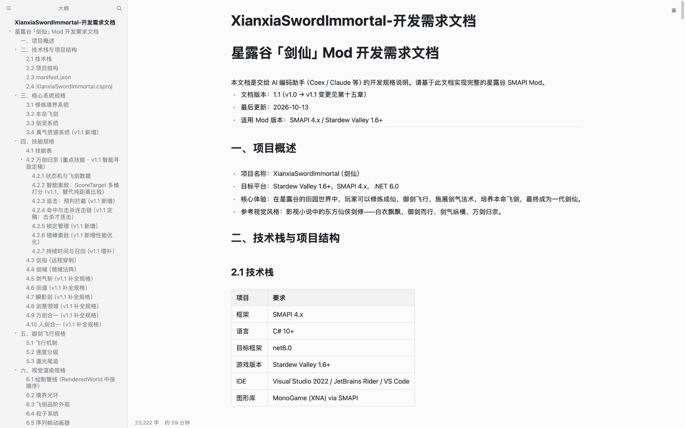
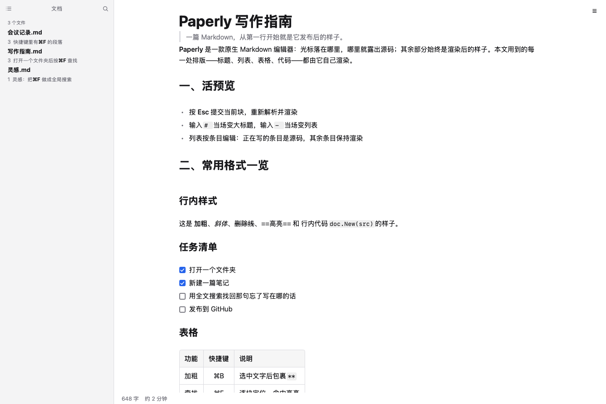

<div align="center">

#  Paperly

**开源、原生、单二进制的 Markdown 编辑器**

光标落在哪里，哪里就露出源码；其余部分始终是你保存后看到的样子。

[](#) [](#) [](#) [](#从源码构建)



</div>

> [!IMPORTANT]
> **当前为早期预览版（v0.1.0）**——核心写作体验已经完整：活预览、条目级编辑、文件管理、全文搜索、双平台 `.md` 关联。但细节仍在打磨，路线图上的功能（表格编辑、跨块选区、导出 PDF）尚未落地。
>
> 遇到 bug、不顺手的地方，或者想要的功能，欢迎 [提 Issue](https://github.com/jiangwanying/paperly/issues)；想直接动手修，[提 PR](https://github.com/jiangwanying/paperly/pulls) 更受欢迎。

---

## 目录

- [为什么做 Paperly](#为什么做-paperly)
- [特性](#特性)
- [快速上手](#快速上手)
- [快捷键](#快捷键)
- [与同类软件对比](#与同类软件对比)
- [安装](#安装)
- [从源码构建](#从源码构建)
- [架构与实现](#架构与实现)
- [路线图](#路线图)
- [常见问题](#常见问题)
- [反馈与贡献](#反馈与贡献)
- [许可证](#许可证)

---

## 为什么做 Paperly

市面上的 Markdown 编辑器分两派：

- **Typora 一派**（所见即所得）：手感好，但整个编辑器是一层 Chromium 套壳，闭源收费；
- **Obsidian / VS Code 一派**（源码 + 预览）：功能强、生态好，但 Electron 动辄两三百 MB 内存占用，或者要左右分栏来回看。

Paperly 走第三条路：**用 Go 写的原生应用，安装包几 MB，内存占用低**，把 Typora 的"块级编辑"和 Obsidian 的"Live Preview"合到一起。核心设计只有一条：

> **真值永远是纯文本 Markdown**——文件就是普通的 `.md`，没有任何私有格式、没有数据库锁定，随时可以换任何其他编辑器继续写。渲染只是一种显示状态：光标进哪个块，哪个块变回源码供你编辑；光标离开，它立刻变回渲染后的样子。

## 特性

### 1. 活预览

- 光标所在行显示源码：`#`、`**`、`` ` `` 等标记淡显，不打断阅读
- 其余所有块保持真渲染：标题字号、加粗、代码芯片、表格、任务勾选框
- **回车即变形**：输入 `# ` 当场变大标题，输入 `- ` 当场变列表，输入 `> ` 当场变引用
- 行首标记（`- `、`> `、`1. `）永远淡显可见——列表不丢圆点，引用不丢标记
- Esc 一键提交当前块，整块重新解析渲染

### 2. 列表条目级编辑

长列表是最常写的结构，Paperly 把 Typora 的"块级进出"细化到了**每一个列表条目**：

<p align="center">
  
</p>

- 正在写的条目是源码输入框，同列表的其余条目是**真渲染**——代码芯片、加粗、编号、悬挂缩进与阅读视图像素级一致
- 点击任意渲染中的条目，光标直接落入该条
- `↑` 在行首跳上一条行尾，`↓` 在行尾跳下一条行首
- 回车在条目尾自动续号开新条（`1.` 会数成 `2.`），行中回车一分为二
- 行首退格并入上一条（自动去标记）；空条目再退格退出列表，变回普通段落

### 3. 文件管理

- **文档树**：浏览文件夹，新建文件/文件夹（树内行内命名，自动补 `.md`）
- **重命名**：右键行内改名；正在编辑的文件被改名时窗口自动跟随新路径，未保存内容不丢失；改名文件夹时，其中所有打开的文档一起跟随
- **删除**：移到系统废纸篓（可找回），有未保存修改的文件会拒绝删除并提示先保存
- 右键任意块（包括图片）：顶层"删除此块"

### 4. 全文搜索

侧栏搜索框输入关键字，从文件名过滤升级为**内容搜索**：

- 列出文件夹内所有命中文件与命中行（行号 + 关键字加粗高亮）
- 点击命中行 → 打开文件并滚动到那一行
- 自动跳过二进制与超大文件，结果缓存防止卡顿

<p align="center">
  
</p>

### 5. 链接与图片

- **链接可点**（阅读态点击不再误入编辑）：
  - `https://…` 与 `mailto:` → 系统默认浏览器
  - `#标题` → 平滑滚动到本文档对应标题
  - 指向文件夹内其他 `.md` 的相对路径 → 在 Paperly 中打开那篇文档（wiki 式互链）
  - 其他存在的文件 → 交给系统默认程序
- **图片**：粘贴或插入自动放入文档旁的 `assets/` 目录（文件名空格自动转义）；独立成段的图片可点击放大（暗色灯箱，点击任意处关闭）

### 6. 写作细节

- **查找替换**：逐块定位、命中高亮（高亮颜色可自定义）
- **大纲面板**：列出全文标题结构，点击直达对应位置
- **撤销**：200 步快照，撤销语义在列表条目编辑中也保持正确
- **状态栏**：字数统计与预计阅读时长
- **保存机制**：每次按键直接写盘——断电、崩溃最多丢一个字符
- **双语界面**：简体中文 / English 跟随系统；**深浅色**跟随系统外观

### 7. 双平台与 .md 文件关联

- **macOS**：dmg 安装包；`Info.plist` 声明 `.md` / `.markdown` 文档类型（Finder"打开方式"可选为默认）；双击 `.md`、Dock 拖入、命令行传路径都能打开
- **Windows**：NSIS 安装器——自定义安装路径、可选桌面快捷方式、自动注册 `.md` 关联（ProgID + OpenWithProgids）、卸载时清理注册表；另附绿色版单文件 exe

---

## 快速上手

1. **打开文件夹**：菜单或侧栏选择你的笔记目录（比如一个 git 仓库的 `docs/`）
2. **点击任意段落**：它当场变成可编辑的源码，光标就位
3. **写**：`# ` 变标题、`- ` 变列表、`**` 包裹加粗——回车智能续行
4. **Esc** 提交当前块；**⌘S** 显式保存（其实每个键已经落盘）
5. **侧栏搜索**：忘了那句话写在哪篇里？输入关键字直达

## 快捷键

| 操作 | macOS | Windows |
| --- | --- | --- |
| 加粗 | ⌘B | Ctrl+B |
| 斜体 | ⌘I | Ctrl+I |
| 行内代码 | Ctrl+` | Ctrl+` |
| 高亮 | ⌘⇧H | Ctrl+Shift+H |
| 查找替换 | ⌘F | Ctrl+F |
| 新建窗口 | ⌘N | Ctrl+N |
| 保存 | ⌘S | Ctrl+S |
| 撤销 / 重做 | ⌘Z / ⌘⇧Z | Ctrl+Z / Ctrl+Y |
| 提交当前块 / 退出编辑 | Esc | Esc |
| 大纲 / 文档树切换 | 侧栏左上角 | 侧栏左上角 |

---

## 与同类软件对比

| | **Paperly** | Typora | Obsidian | MarkText | VS Code |
| --- | --- | --- | --- | --- | --- |
| 价格 | 免费开源 | $14.99 闭源 | 个人免费闭源 | 免费开源 | 免费开源 |
| 技术栈 | **Go 原生** | Chromium | Electron | Electron | Electron |
| 安装包体积 | **4–13 MB** | ~100 MB | ~300 MB | ~250 MB | ~350 MB |
| 编辑模式 | 块级活预览 | 富文本所见即所得 | Live Preview | 所见即所得 | 源码 + 预览 |
| 非光标行真渲染 | ✅ | ✅ | ✅ | ✅ | ❌ 需另开预览 |
| 列表条目级编辑 | ✅ | ✅ | 部分 | ✅ | ❌ |
| 文件树增删改 | ✅ | ✅ | ✅ | ✅ | ✅ |
| 全文搜索 | ✅ 命中行直达 | ✅ | ✅ 更强 | ✅ | ✅ 更强 |
| .md 文件关联 | ✅ 双平台内置 | ✅ | ✅ | ✅ | 手动配置 |
| 插件生态 | 路线图中 | ❌ | ✅ 海量 | 弱 | ✅ 海量 |
| 跨块字符级选区 | 块级（路线图） | ✅ | ✅ | ✅ | ✅ |
| 内存占用 | **低（原生）** | 中 | 高 | 高 | 高 |
| 中文界面 | ✅ 原生 | ✅ | ✅ | 部分 | 语言包 |

**各家一句话**：

- **Typora**：手感标杆，闭源收费，底层是整个 Chromium——体积与内存都下不来。
- **Obsidian**：双链笔记之王、插件生态无敌，但 Electron 重，且核心闭源；Live Preview 是它近年补上的，思路与 Paperly 相同。
- **MarkText**：开源 Electron 所见即所得，可惜多年维护停滞，问题修复慢。
- **VS Code**：万能编辑器配 Markdown 插件很好用，但它是代码编辑器，不是专注写作的应用；预览是另一栏。

**Paperly 的定位**：如果你想要 Typora 的手感、Obsidian 的活预览，但不想为闭源付费、不想背着两百 MB 的 Electron——这是一个单文件、几 MB、数据永远是纯 Markdown 的选择。

**诚实说明 v0.1 的边界**：表格编辑、跨块字符级选区、图片拖拽导入、导出 PDF 在路线图上；没有插件系统；目前覆盖 macOS（Intel）与 Windows（x64）。

---

## 安装

从 [Releases](https://github.com/jiangwanying/paperly/releases) 下载：

### macOS

1. 下载对应芯片的安装包：Apple Silicon（M1/M2/M3/M4）选 `paperly-x.y.z-arm64.dmg`，Intel 芯片选 `paperly-x.y.z-amd64.dmg`（不确定就点  → 关于本机 → "芯片"一行），把 Paperly 拖入"应用程序"
2. 首次打开如果提示"无法验证开发者"（未做公证）：右键 → 打开 → 再点打开，只需一次
3. 设为默认 Markdown 编辑器：Finder 中右键任意 `.md` 文件 → 显示简介 → 打开方式 → Paperly → 全部更改

### Windows

1. 下载 `paperly-setup-x.y.z-amd64.exe` 双击安装（可自定义安装路径，完成页可勾选创建桌面快捷方式）
2. `.md` 关联在安装时自动写入注册表；在"设置 → 默认应用"或文件右键"打开方式"中设为默认
3. 不想安装？下载 `Paperly.exe` 绿色版直接运行

### 从命令行打开

```bash
# macOS
open -a Paperly 笔记.md
# Windows（安装器版本）
paperly 笔记.md
```

---

## 从源码构建

依赖：[Go](https://go.dev) 1.27+ 与 [MyGo](https://github.com/egoist/mygo) UI 工具链（含 `mygo` 命令行）。

```bash
git clone https://github.com/jiangwanying/paperly.git
cd paperly

# 跑全部测试（10 组测试文件，覆盖编辑器行为全链路的离屏渲染测试）
go test ./...

# 构建本机可执行文件
go build -o paperly .

# 打包 macOS app 与 dmg
mygo build

# 打包 Windows exe 与 NSIS 安装器（需要 makensis）
mygo build -platform windows/amd64
```

---

## 架构与实现

```
┌────────────────────────────────────────────────────────────┐
│ mygo.json          打包配置（版本 / 文档类型声明 / 文件关联）  │
├────────────────────────────────────────────────────────────┤
│ internal/editor    块级编辑器：编辑状态机、活预览、文件管理     │
│                    全文搜索、查找高亮、大纲、平台集成          │
├────────────────────────────────────────────────────────────┤
│ internal/doc       Markdown 文档模型：块解析、增量编辑、      │
│                    语法区间、撤销快照                          │
├────────────────────────────────────────────────────────────┤
│ MyGo ui            原生 UI 框架：声明式元素树、每帧重建、      │
│                    文本区间样式、markdown.View 渲染视图        │
└────────────────────────────────────────────────────────────┘

数据流：按键 → 草稿(draft) → sync() → doc.Replace(span, draft) → 磁盘
        （每个按键都写盘，文件与屏幕永远一致）
```

### internal/doc —— 文档模型

- **块级解析**：文档 = 块列表（标题、段落、列表、引用、围栏代码、表格、分隔线），每个块携带源码跨度 `Span{Start, End}`，块之间的空行不属于任何块
- **增量编辑**：编辑只对活跃块调用 `Replace(span, draft)`，文档重新解析时其余块原样保留——这是"块级编辑"廉价的根本原因
- **语法区间 `SyntaxRuns`**：把一段源码切成带类型的区间——`RunPrefix`（行首标记：`- `/`> `/`# `/任务勾选框/围栏，逐行匹配，多行列表每行都有自己的前缀）与 `RunMarker`（行内标记：`**`、`*`、`` ` ``）——渲染层把它们转成文本区间样式
- **偏移换算**：`RuneOffset` / `ByteOffset` 在 rune 坐标（输入框的选区）与字节坐标（文档源码）之间转换
- **撤销**：200 步文档快照栈

### internal/editor —— 块级编辑器

**一个块有三种状态**：阅读态（`markdown.View` 真渲染）、整块编辑（`TextArea` 绑定整块草稿）、条目级编辑（多行列表，见下）。点击阅读态的块进入编辑，Esc 提交回到阅读态。

**编辑管线**：输入框绑定草稿 → 每次变化触发 `sync()` → `doc.Replace(块跨度, 草稿)`。管线里最难的部分是**跨度容差**：Markdown 解析器对"还没写完的行"（空列表项 `2. `、空引用 `> `、行尾空格）持有的跨度比草稿短，直接替换会留下游离字符。`sync()` 用一条多级容差链消化它：

```
跨度扩展（草稿比跨度长且尾部吻合 → 扩到草稿末尾）
→ 自愈（块内容比草稿多 → 以草稿为准，清除解析器泄漏的杂散字节）
→ 收养（草稿跨到了下一个块 → 活跃块跟随移动）
→ 转 pending（草稿以空行结尾 → 新段落从光标处开始）
```

这条链保证**解析器的任何泄漏都不会出现在文件里**——写作者的草稿永远是真值。

**条目级编辑**是编辑器里最复杂的状态机：草稿仍是整块源码，但输入框只绑定当前条目那一行（`lineDraft`），其余行交给渲染视图。条目光标（`itemLine` / `itemCaret`）与草稿偏移双向映射（`refocusItem`）；回车、退格在条目坐标系里完成语义判断（续号、拆分、并入、退出列表），再落到整块草稿上走同一条管线。

**活预览**：每帧构建时读取输入框光标所在行，行内标记（`**` 等）只在该行淡显，其余行染成页面背景色隐藏；行首标记永远淡显——隐藏它们会让列表丢圆点，而纯文本层画不出圆点。查找命中、拼写外的语义高亮走同一套文本区间机制。

**平台集成**：

- 废纸篓：macOS 走 Finder（AppleScript），Windows 走 PowerShell 调用 .NET 回收站 API——删除可找回
- 文件跟随：重命名文件/文件夹时，遍历打开的文档做路径映射，未保存内容先写到新路径再静默重开
- 全文搜索：递归读取 `.md`（跳过二进制与 >1MB 文件、单文件最多 3 行命中、整目录 1 秒结果缓存）
- 文件关联：macOS 由打包器把配置写入 `Info.plist`，Windows 写入注册表；运行时注册系统"打开文件"事件，双击 `.md` / 拖到 Dock / 命令行路径都会开新窗口

### 与 UI 框架协作的工程细节

实时渲染编辑器对 UI 框架的要求非常苛刻，几个值得记录的实现细节：

- **跨帧元素一律过期**：按键回调闭包里持有的输入框句柄，到下一帧就失效（框架每帧重建元素树）——按键处理只读镜像值，绝不在回调里调用元素方法
- **命令式写入**：在按键回调里改写绑定值不够（框架会用它持有的内容覆盖回来），必须通过 `TextKey.SetText` 命令式告知——列表条目合并就是靠这个修复的
- **光标镜像**：程序化设置光标（如回车续行后落到新条目）时同步更新镜像选区，否则下一个按键会读到晚一帧的位置
- **文本区间只有颜色和字重**：没有"替换成渲染元素"的原语（CodeMirror 的 replace/widget），所以非光标行的"隐藏"用页面背景色实现——同时靠条目级编辑把渲染的精度补足到像素级

### 测试

编辑器的正确性靠**离屏渲染测试**保障：`ui.Tester` 驱动整棵 UI 树，模拟点击坐标、按键序列、输入法整词提交、多事件同帧突发，然后断言文档源码与编辑状态机。10 组测试文件覆盖：块解析与语法区间、活预览显隐切换、条目编辑全链路（续行/拆分/并入/退列表/撤销）、空行退格与并入、文件树增删改与废纸篓、全文搜索、菜单结构。

---

## 路线图

- [ ] 表格编辑（网格化单元格编辑）
- [ ] 跨块字符级选区（整篇复制已支持，连续拖选评估中）
- [ ] 图片拖拽导入、缩放与对齐语法
- [ ] 导出 PDF / 打印
- [ ] 大文档性能优化（视口裁剪）

## 常见问题

**为什么又造一个 Markdown 编辑器？**
因为想要的东西恰好没人同时给：Typora 的手感 + 开源 + 原生体积 + 数据永远是纯 Markdown。

**文件会被锁进什么私有格式吗？**
不会。Paperly 读写的永远是普通 `.md` 纯文本，图片是文件夹里的普通文件，卸载软件后你的笔记毫发无损。

**支持 Vim/Emacs 键位吗？**
暂不支持，路线图评估中。

---

## 反馈与贡献

预览版阶段，你的反馈比什么都重要：

- **提 [Issue](https://github.com/jiangwanying/paperly/issues)**：bug、体验不顺手、功能建议都欢迎——哪怕只是一句"这里不对劲"。能附上版本号、系统版本、复现步骤或截图，修起来就快得多
- **提 [PR](https://github.com/jiangwanying/paperly/pulls)**：想直接动手修就更好了。流程：fork → 建分支 → 改完跑 `go test ./...` → 提交 PR。编辑器的行为改动请顺手带上对应的离屏渲染测试（参考 `internal/editor` 里现有测试的写法）
- **想先聊聊**：架构、实现方式、或者拿不准要不要做某个功能，开一个 Issue 标题写 `[讨论]` 就行

代码结构见 [架构与实现](#架构与实现)，从零跑起来的命令见 [从源码构建](#从源码构建)。

---

## 许可证

本项目基于 [MIT](LICENSE) 协议开源。
